**BỘ GIÁO DỤC VÀ ĐÀO TẠO**  
**TRƯỜNG ĐẠI HỌC CÔNG NGHỆ TP. HỒ CHÍ MINH (HUTECH)**  
**KHOA CÔNG NGHỆ THÔNG TIN**  

---

# BÁO CÁO ĐỒ ÁN MÔN HỌC
### HỌC PHẦN: LẬP TRÌNH TRÊN THIẾT BỊ DI ĐỘNG (ECMP177)

**ĐỀ TÀI:**  
## LIFEQUEST – ỨNG DỤNG QUẢN LÝ MỤC TIÊU VÀ NHIỆM VỤ GAMIFICATION TÍCH HỢP AI, PHÂN QUYỀN HỆ THỐNG VÀ ĐỒNG BỘ NHÓM THỜI GIAN THỰC TRÊN THIẾT BỊ DI ĐỘNG

**Nhóm sinh viên thực hiện:** Nhóm 10  
1. **Nguyễn Viết Lãm** – MSSV: 2380601183 (Trưởng nhóm)  
2. **Trần Ngọc Lợi** – MSSV: 2380601292  
3. **Nguyễn Đại Kỳ** – MSSV: 2380601178  
4. **Châu Tuấn** – MSSV: 2380602434  

**Lớp:** 23DTHB6  
**Giảng viên phụ trách:** ThS. [Chèn tên Giảng viên phụ trách]  
**Học kỳ – Năm học:** Học kỳ 1 – Năm học 2026-2027  

\newpage

# BẢNG PHÂN CÔNG CÔNG VIỆC VÀ TỶ LỆ ĐÓNG GÓP

| STT | Họ và tên | MSSV | Vai trò | Trách nhiệm và Nội dung công việc đảm nhiệm | Tỷ lệ hoàn thành | % Đóng góp (/100%) |
|:---:|---|:---:|:---:|---|:---:|:---:|
| 1 | **Nguyễn Viết Lãm** | 2380601183 | **Trưởng nhóm** | - Thiết kế kiến trúc hệ thống Client - Server tổng thể. - Xây dựng Backend REST API (Node.js/Express, SQLite 9 bảng). - Thiết lập cơ chế bảo mật: Băm mật khẩu bcrypt, băm mã mời SHA-256, xác thực JWT, chống brute-force rate-limit. - Xây dựng phân hệ Quản trị viên (Admin Dashboard) và cơ chế phân quyền hệ thống. - Lập trình kết nối Realtime SSE (Server-Sent Events) đồng bộ đa thiết bị. - Viết bộ kiểm thử tự động Backend (12/12 tests PASS) và quản trị Git Repository. | 100% | **35%** |
| 2 | **Trần Ngọc Lợi** | 2380601292 | Thành viên | - Thiết kế và lập trình giao diện Flutter màn hình Trang chủ (HomeScreen) và Danh sách nhiệm vụ (QuestsScreen). - Hiện thực hóa mô hình Gamification (Điểm kinh nghiệm XP, tính Level theo công thức toán học, chuỗi ngày Streak, Huy hiệu). - Tối ưu hóa trải nghiệm người dùng theo phong cách Minimalism (Tối giản - Taste-Skill) trên thiết bị di động. | 100% | **25%** |
| 3 | **Nguyễn Đại Kỳ** | 2380601178 | Thành viên | - Thiết kế và lập trình giao diện không gian Nhóm & CLB (GroupsScreen). - Xây dựng luồng tạo nhóm, chia sẻ mã mời bảo mật, quản lý thành viên và quest nhóm. - Tích hợp Dio/ApiClient và quản trị trạng thái (State Management) với Flutter Riverpod. - Tối ưu hóa điều hướng ứng dụng (GoRouter). | 100% | **25%** |
| 4 | **Châu Tuấn** | 2380602434 | Thành viên | - Hỗ trợ lập trình giao diện màn hình Trợ lý AI (AiScreen) cơ bản với luồng xem trước (Preview Draft). - Hỗ trợ thiết kế giao diện Trung tâm An toàn (Safety Center) gửi báo cáo vi phạm. - Thực hiện kiểm thử thủ công (Manual Testing) trên thiết bị di động thực tế. - Thu thập ảnh chụp minh chứng giao diện, hỗ trợ tổng hợp báo cáo và chuẩn bị Slide Canva thuyết trình. | 100% | **15%** |
| **Tổng cộng** | | | | | | **100%** |

\newpage

# MỤC LỤC & DANH MỤC HÌNH ẢNH

### DANH MỤC HÌNH ẢNH MINH CHỨNG
* **Hình 1:** Giao diện Đăng nhập hệ thống và cơ chế Rate Limiting chống dò mật khẩu
* **Hình 2:** Giao diện Đăng ký tài khoản mới và kiểm tra ràng buộc dữ liệu
* **Hình 3:** Giao diện Khảo sát thiết lập ban đầu (Onboarding Screen)
* **Hình 4:** Giao diện Trang chủ Gamification (XP, Level, Streak, Huy hiệu danh dự)
* **Hình 5:** Giao diện Danh sách nhiệm vụ và Bộ lọc tìm kiếm linh hoạt
* **Hình 6:** Giao diện Khởi tạo nhiệm vụ mới kèm Checklist từng bước và Deadline
* **Hình 7:** Giao diện Hoàn thành nhiệm vụ nhận XP và minh chứng cơ chế Idempotent
* **Hình 8:** Giao diện Trợ lý AI gợi ý phân rã mục tiêu (Review-before-save)
* **Hình 9:** Giao diện Bộ lọc kiểm duyệt an toàn AI (Safety Moderation Filter)
* **Hình 10:** Giao diện Danh sách Nhóm và CLB rèn luyện
* **Hình 11:** Giao diện Quản lý chi tiết thành viên và Mã mời tham gia nhóm
* **Hình 12:** Giao diện Đồng bộ thời gian thực 2 chiều giữa các thiết bị (Realtime SSE)
* **Hình 13:** Giao diện Trung tâm An toàn (Safety Center: Báo cáo vi phạm và Chặn người dùng)
* **Hình 14:** Giao diện Bảng điều khiển Quản trị viên (Admin Dashboard: Giám sát toàn hệ thống)
* **Hình 15:** Giao diện Quản trị viên xử lý báo cáo vi phạm và quản lý danh sách người dùng
* **Hình 16:** Giao diện Hồ sơ cá nhân, Chế độ tối (Dark Mode) và Đổi mật khẩu

\newpage

# 1. KẾT QUẢ THỰC NGHIỆM

## 1.1. Tổng hợp chức năng và công nghệ sử dụng

**Link dự án GitHub (Chế độ Public):**  
<https://github.com/Nguyen-Viet-Lam/LapTrinhTrenThietBiDiDong.git>

### a. Công nghệ sử dụng trong dự án

| Thành phần | Công nghệ / Thư viện | Mục đích sử dụng |
|---|---|---|
| **Mobile App (Frontend)** | Flutter 3.x / Dart 3.x (Material 3) | Xây dựng ứng dụng di động đa nền tảng (ưu tiên Android, hỗ trợ iOS và Web Responsive). |
| **Kiến trúc UI/UX** | Minimalism (Taste-Skill) | Tối giản, thanh lịch, nền dịu mắt `#F8FAFC`, bề mặt phẳng viền 1px, loại bỏ hoàn toàn "AI-slop". |
| **Quản lý trạng thái** | Flutter Riverpod 2.x | Quản lý state toàn ứng dụng, tách biệt hoàn toàn tầng logic và giao diện hiển thị. |
| **Điều hướng (Routing)** | GoRouter | Quản lý điều hướng khai báo (declarative routing), tự động bảo vệ route (Route Guard) theo vai trò. |
| **Backend & REST API** | Node.js + Express (thư mục `backend/`) | Cung cấp RESTful API cho toàn bộ nghiệp vụ: tài khoản, nhiệm vụ, nhóm, AI, an toàn, quản trị. |
| **Cơ sở dữ liệu** | SQLite (`node:sqlite`) | CSDL quan hệ chuẩn với 9 bảng liên kết khóa ngoại (`ON DELETE CASCADE`), quản lý phiên bản migration `.sql`. |
| **Bảo mật & Phân quyền** | JWT, bcryptjs, crypto SHA-256 | Băm mật khẩu người dùng (bcrypt salt 10), băm mã mời nhóm (SHA-256), token JWT hết hạn 7 ngày, phân quyền Admin / User. |
| **Đồng bộ thời gian thực** | Server-Sent Events (SSE) | Kênh kết nối một chiều nhẹ, đẩy sự kiện thời gian thực khi có thay đổi trong nhóm đến mọi thiết bị. |
| **Trí tuệ nhân tạo (AI)** | Gemini API + Bộ lọc Moderation | Phân tích và chia nhỏ mục tiêu thành kế hoạch chi tiết; có cơ chế Mock an toàn khi không có internet/API key. |
| **Lưu trữ cục bộ** | SharedPreferences | Lưu trữ JWT token và thiết lập cá nhân (chế độ sáng/tối, thông báo) trên thiết bị di động. |
| **Triển khai Web Demo** | Firebase Hosting | Host bản Web trực tuyến thử nghiệm: <https://flutter-firebase-6b5af.web.app>. |
| **Kiểm thử tự động** | flutter_test, node:test | Kiểm thử tự động từ Unit Test, Widget Test cho tới Integration Test toàn diện. |

### b. Bảng tổng hợp chức năng và phân quyền hệ thống

> **Nguyên tắc phân quyền nghiêm ngặt:**  
> - **Quản trị viên (Admin - `lam@lifequest.vn`):** Chuyên trách quản trị, giám sát số liệu toàn hệ thống, danh sách tài khoản, xử lý báo cáo vi phạm, áp đặt hạn chế/khóa tài khoản vi phạm. Admin **không** làm nhiệm vụ to-do cá nhân để đảm bảo tính chuyên biệt và khách quan.  
> - **Người dùng (User - `ky@...`, `loi@...`, `tuan@...`, `demo@...`):** Sử dụng các tính năng đời thường gồm rèn luyện nhiệm vụ, thăng cấp Gamification, tương tác nhóm, hỏi trợ lý AI và sử dụng các công cụ an toàn.

| STT | Phân hệ | Chức năng chi tiết | Vai trò áp dụng | Trạng thái Backend | Trạng thái App |
|:---:|---|---|:---:|:---:|:---:|
| 1 | Tài khoản | Đăng ký tài khoản mới kèm kiểm tra tính hợp lệ | Khách | Hoàn thành | Hoàn thành |
| 2 | Tài khoản | Đăng nhập JWT (phiên 7 ngày), băm mật khẩu bcrypt | Tất cả | Hoàn thành | Hoàn thành |
| 3 | Tài khoản | Chống brute-force: khóa tạm thời 15 phút khi sai 5 lần liên tiếp | Tất cả | Hoàn thành | Hoàn thành |
| 4 | Tài khoản | Khảo sát định hướng sở thích ban đầu (Onboarding) | Người dùng | Hoàn thành | Hoàn thành |
| 5 | Tài khoản | Đổi mật khẩu tài khoản có xác thực mật khẩu cũ | Tất cả | Hoàn thành | Hoàn thành |
| 6 | Tài khoản | Chuyển đổi giao diện Sáng / Tối (Dark Mode) | Tất cả | Hoàn thành | Hoàn thành |
| 7 | Gamification | Hệ thống tích lũy XP và tính Level theo công thức bình phương | Người dùng | Hoàn thành | Hoàn thành |
| 8 | Gamification | Ghi nhận chuỗi ngày hoạt động liên tục (Streak) | Người dùng | Hoàn thành | Hoàn thành |
| 9 | Gamification | Danh mục huy hiệu danh dự tự động mở khóa theo thành tích | Người dùng | Hoàn thành | Hoàn thành |
| 10 | Nhiệm vụ | Tạo nhiệm vụ cá nhân kèm checklist các bước và hạn chót | Người dùng | Hoàn thành | Hoàn thành |
| 11 | Nhiệm vụ | Tìm kiếm, lọc nhiệm vụ theo danh mục và trạng thái | Người dùng | Hoàn thành | Hoàn thành |
| 12 | Nhiệm vụ | Cơ chế Hoàn thành nhiệm vụ nhận XP Idempotent (chỉ cộng 1 lần) | Người dùng | Hoàn thành | Hoàn thành |
| 13 | Trợ lý AI | Gợi ý chia nhỏ mục tiêu theo độ khó (Review-before-save) | Người dùng | Hoàn thành | Hoàn thành |
| 14 | Trợ lý AI | Bộ lọc kiểm duyệt (Moderation) từ chối mục tiêu nguy hiểm | Người dùng | Hoàn thành | Hoàn thành |
| 15 | Nhóm & CLB | Tạo nhóm rèn luyện, sinh mã mời bảo mật (băm SHA-256) | Người dùng | Hoàn thành | Hoàn thành |
| 16 | Nhóm & CLB | Tham gia nhóm bằng mã mời hợp lệ (hết hạn sau 7 ngày) | Người dùng | Hoàn thành | Hoàn thành |
| 17 | Nhóm & CLB | Giao nhiệm vụ cho thành viên, quản lý thành viên nhóm | Chủ nhóm | Hoàn thành | Hoàn thành |
| 18 | Nhóm & CLB | Đồng bộ dữ liệu nhóm thời gian thực qua Server-Sent Events (SSE) | Thành viên nhóm | Hoàn thành | Hoàn thành |
| 19 | An toàn | Gửi báo cáo vi phạm nội dung / người dùng xấu kèm lý do | Người dùng | Hoàn thành | Hoàn thành |
| 20 | An toàn | Chặn người dùng (Block) và tự động ẩn quest của người bị chặn | Người dùng | Hoàn thành | Hoàn thành |
| 21 | Quản trị | Bảng điều khiển Admin giám sát số lượng user, quest, báo cáo | Quản trị viên | Hoàn thành | Hoàn thành |
| 22 | Quản trị | Quản lý danh sách tài khoản, khóa hoặc hạn chế quyền truy cập | Quản trị viên | Hoàn thành | Hoàn thành |
| 23 | Quản trị | Xem xét và xử lý các báo cáo vi phạm từ cộng đồng | Quản trị viên | Hoàn thành | Hoàn thành |
| 24 | Thông báo | Push Notification đẩy qua hệ điều hành (FCM) | Tất cả | Chưa xây dựng | Chưa xây dựng |
| 25 | Tài khoản | Đăng nhập bằng Google / Quên mật khẩu qua email SMTP | Tất cả | Chưa xây dựng | Chưa xây dựng |

---

## 1.2. Minh họa chi tiết các chức năng

*(Các hình ảnh minh chứng được trích xuất trực tiếp từ bản dựng thực tế của ứng dụng trên môi trường điện thoại và máy tính)*

### Chức năng 1: Xác thực tài khoản & Quản lý phiên an toàn
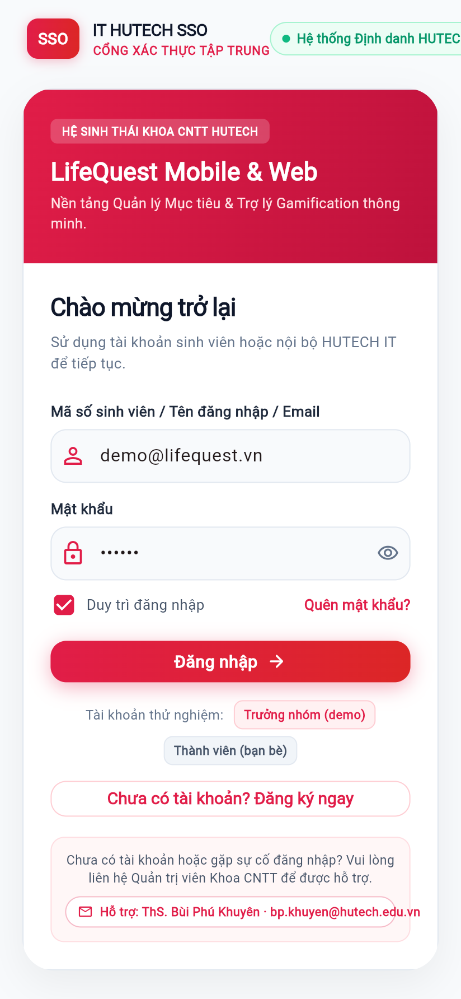{width=42%}

**Mô tả kết quả thực nghiệm:**  
Người dùng nhập email và mật khẩu (tối thiểu 6 ký tự). Hệ thống băm mật khẩu bằng thuật toán **bcrypt** (salt rounds = 10) trước khi so khớp với CSDL, tuyệt đối không lưu mật khẩu dạng văn bản thô (plain-text). Khi đăng nhập thành công, máy chủ cấp một mã JWT có thời hạn 7 ngày để xác thực cho mọi tác vụ tiếp theo.  
**Cơ chế chống brute-force:** Phía Backend tích hợp cơ chế Rate Limiting nghiêm ngặt. Nếu một tài khoản nhập sai mật khẩu quá 5 lần liên tiếp trong vòng 15 phút, hệ thống lập tức khóa truy cập tạm thời và phản hồi mã lỗi `429 Too Many Requests`.

---

### Chức năng 2: Đăng ký & Thiết lập sở thích ban đầu (Onboarding)
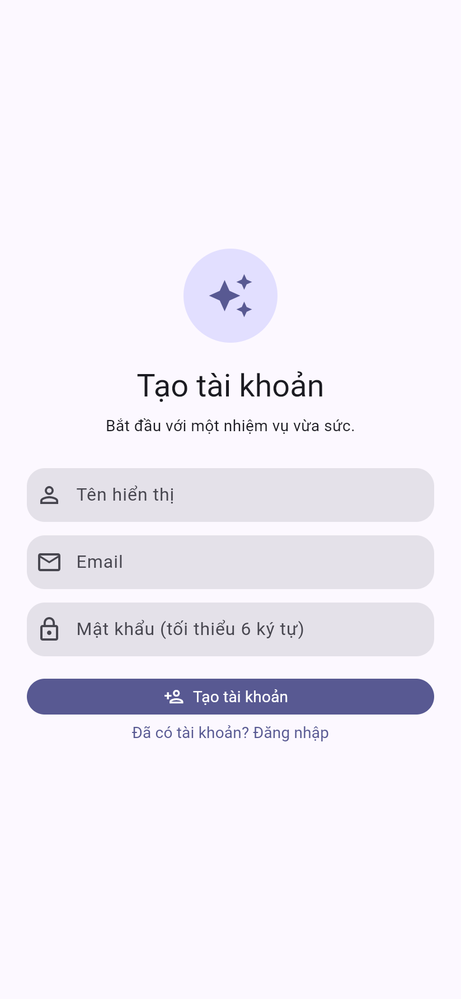{width=42%}

**Mô tả kết quả thực nghiệm:**  
Màn hình đăng ký cho phép người dùng nhập họ tên, email và mật khẩu mới. Hệ thống kiểm tra tính duy nhất của email (trùng lặp trả mã lỗi `409 Conflict`). Sau khi đăng ký thành công, người dùng mới được dẫn vào màn hình Onboarding để lựa chọn các lĩnh vực quan tâm cá nhân (Sức khỏe, Học tập, Thể thao, Phát triển bản thân). Dữ liệu này được lưu trữ có cấu trúc JSON trong trường `interests` của bảng `users` nhằm tối ưu hóa các gợi ý nhiệm vụ sau này.

---

### Chức năng 3: Bảng điều khiển Trang chủ & Hệ thống Gamification
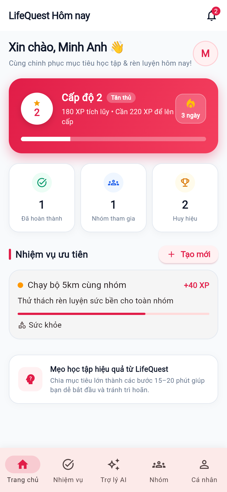{width=42%}

**Mô tả kết quả thực nghiệm:**  
Trang chủ hiển thị trực quan thông tin rèn luyện của người dùng: tên hiển thị, tổng điểm kinh nghiệm (XP), cấp độ (Level), chuỗi ngày hoạt động liên tục (Streak) và bộ sưu tập huy hiệu danh dự đã mở khóa.  
Cấp độ được tính toán nhất quán theo công thức toán học:
$$\text{Level} = \left\lfloor\sqrt{\frac{\text{XP}}{100}}\right\rfloor + 1$$
API `GET /api/stats` cung cấp dữ liệu số XP còn thiếu để thăng cấp tiếp theo cùng tỷ lệ hoàn thành các nhiệm vụ ưu tiên trong ngày. Giao diện được thiết kế phẳng (Flat Design) kết hợp phong cách Minimalism dịu mắt, giúp người dùng tập trung hoàn toàn vào mục tiêu của mình.

---

### Chức năng 4: Quản lý và Khởi tạo Nhiệm vụ (Quest)
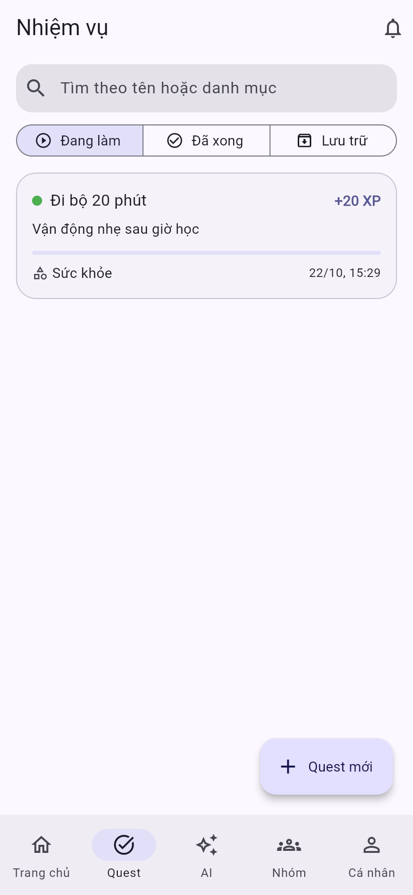{width=40%} 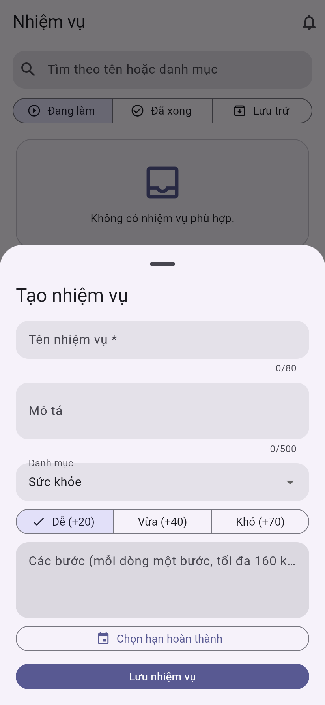{width=40%}

**Mô tả kết quả thực nghiệm:**  
Người dùng khởi tạo nhiệm vụ bằng cách nhập tiêu đề, mô tả, danh mục, mức độ khó (Dễ: 20 XP, Vừa: 40 XP, Khó: 70 XP), thời hạn hoàn thành (Deadline) và danh sách các bước hành động cụ thể (Checklist).  
Tại màn hình danh sách, người dùng có thể tìm kiếm theo từ khóa theo thời gian thực và lọc theo trạng thái (Đang thực hiện, Đã hoàn thành, Đã lưu trữ). Mỗi khi một bước con được đánh dấu xong, thanh tiến độ (Progress bar) tự động tính toán lại tỷ lệ hoàn thành theo thời gian thực.

---

### Chức năng 5: Cơ chế Hoàn thành nhiệm vụ Idempotent (Chống hack điểm)
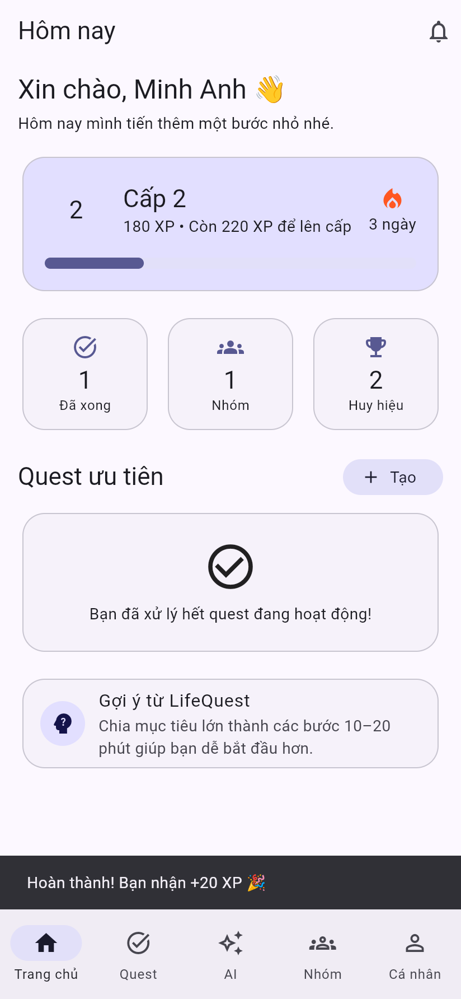{width=42%}

**Mô tả kết quả thực nghiệm:**  
Khi người dùng hoàn thành toàn bộ các bước và nhấn nút **"Hoàn thành nhiệm vụ"**, hệ thống thực thi một Database Transaction nguyên tử (Atomic): đánh dấu nhiệm vụ chuyển sang trạng thái `completed`, cộng điểm XP tương ứng vào tài khoản và cập nhật chuỗi Streak nếu đây là nhiệm vụ đầu tiên hoàn thành trong ngày.  
**Điểm nhấn kỹ thuật:** Cơ chế **Idempotency** bảo đảm tính toàn vẹn dữ liệu tuyệt đối. Nếu người dùng vô tình bấm nhiều lần hoặc có kẻ gian cố tình gọi lặp lại API `POST /api/quests/:id/complete`, CSDL kiểm tra cờ `xp_awarded`. Các lần gọi sau đều trả về `{ idempotent: true, xpAwarded: 0 }`, bảo đảm điểm thưởng XP chỉ được cấp đúng một lần duy nhất.

---

### Chức năng 6: Trợ lý AI phân rã mục tiêu (Review-before-save & Moderation)
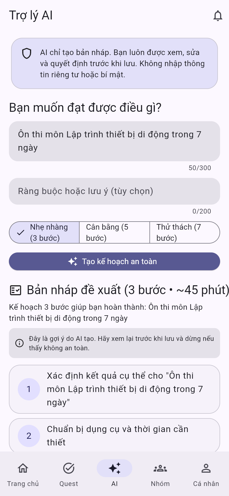{width=42%}

**Mô tả kết quả thực nghiệm:**  
Người dùng chỉ cần nhập một mục tiêu lớn (ví dụ: *"Ôn thi môn Lập trình di động trong 7 ngày"*), Trợ lý AI (tích hợp Gemini API qua máy chủ trung gian) sẽ tự động phân tích và sinh ra một kế hoạch hành động chia nhỏ gồm 3, 5 hoặc 7 bước thực hiện cụ thể.  
**Luồng Review-before-save:** AI không bao giờ tự ý lưu thẳng vào CSDL. Bản thảo được hiển thị trên giao diện để người dùng tự do đọc, chỉnh sửa câu chữ hoặc thêm bớt các bước theo nhu cầu thực tế trước khi bấm *"Lưu thành nhiệm vụ của tôi"*.  
**Bộ lọc an toàn (Safety Moderation):** Trước khi chuyển yêu cầu đến mô hình ngôn ngữ lớn, máy chủ chạy qua lớp kiểm duyệt an toàn. Mọi mục tiêu chứa nội dung tiêu cực, bạo lực hay vi phạm tiêu chuẩn cộng đồng đều bị từ chối ngay lập tức với mã lỗi `422 Unprocessable Entity`.

---

### Chức năng 7: Không gian Nhóm & Đồng bộ Thời gian thực (SSE Realtime)
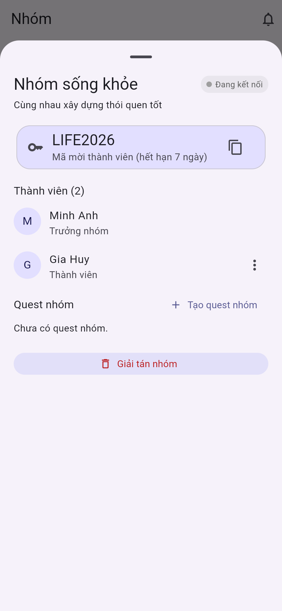{width=40%} 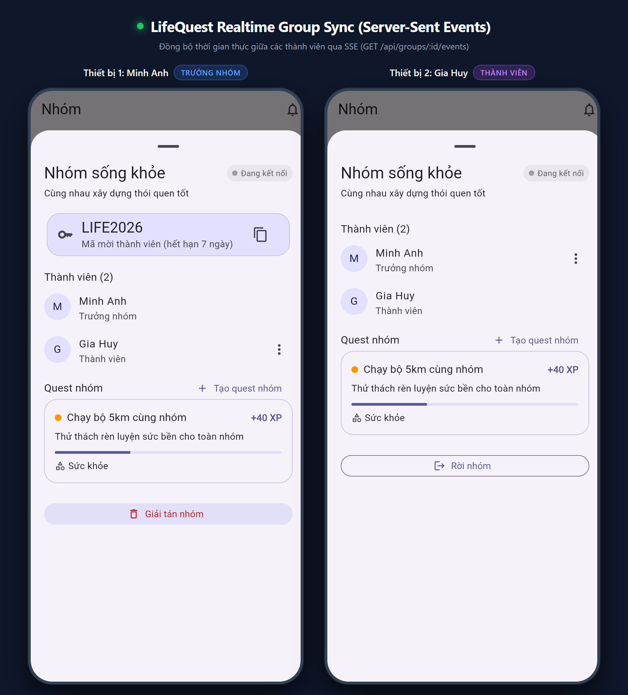{width=40%}

**Mô tả kết quả thực nghiệm:**  
Người dùng có thể tạo nhóm rèn luyện hoặc câu lạc bộ học tập. Để mời bạn bè tham gia, hệ thống sinh ra một mã mời ngẫu nhiên có hiệu lực trong vòng 7 ngày. Mã mời được lưu trong CSDL dưới dạng chuỗi băm **SHA-256** để chống lộ lọt dữ liệu.  
**Cơ chế Realtime SSE:** Khi thành viên mở màn hình chi tiết nhóm, ứng dụng thiết lập một kết nối Server-Sent Events qua endpoint `GET /api/groups/:id/events`. Bất cứ khi nào có thành viên tạo quest nhóm mới, tích hoàn thành một bước hoặc có người mới vào nhóm, máy chủ sẽ phát (emit) sự kiện tức thời đến toàn bộ các thiết bị đang kết nối. Giao diện nhóm tự động cập nhật dữ liệu mới mà người dùng không cần phải vuốt làm mới hoặc tải lại trang.

---

### Chức năng 8: Trung tâm An toàn (Safety Center) & Kiểm soát Người dùng
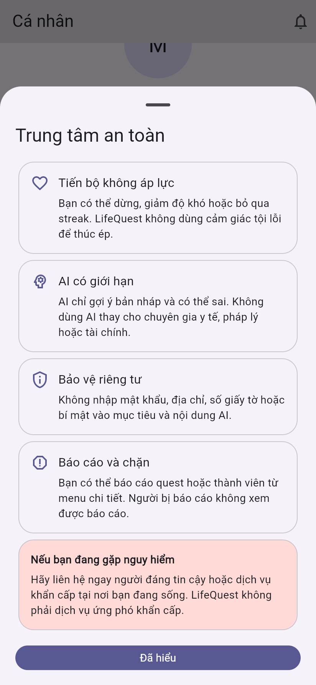{width=42%}

**Mô tả kết quả thực nghiệm:**  
Nhằm xây dựng môi trường sinh hoạt lành mạnh, LifeQuest cung cấp Trung tâm An toàn cho phép người dùng:  
1. **Gửi báo cáo vi phạm:** Báo cáo các bài đăng, nội dung nhiệm vụ hoặc thành viên có hành vi quấy rối/spam kèm lý do chi tiết (tối đa 500 ký tự). Dữ liệu này được chuyển thẳng về bảng `reports` để Quản trị viên xử lý.  
2. **Chặn người dùng (Block):** Người dùng có thể chủ động chặn các tài khoản không mong muốn. Ngay khi lệnh chặn được thiết lập, câu truy vấn CSDL tại API `GET /api/quests` sẽ tự động lọc và ẩn toàn bộ các nhiệm vụ nhóm do người bị chặn tạo ra đối với người chặn.

---

### Chức năng 9: Phân hệ Quản trị viên (Admin Dashboard)
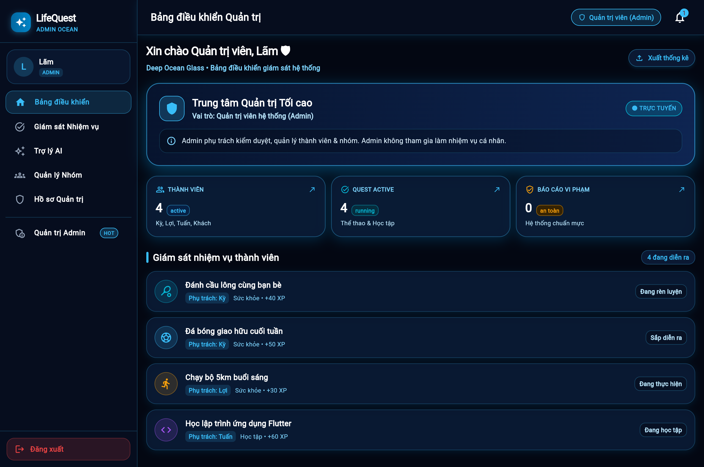{width=42%}

**Mô tả kết quả thực nghiệm:**  
Khi đăng nhập bằng tài khoản Quản trị viên (`lam@lifequest.vn`), hệ thống tự động nhận diện vai trò `admin` và điều hướng về Bảng điều khiển Quản trị chuyên biệt.  
- Admin có quyền xem xét số liệu tổng quan toàn hệ thống: tổng số tài khoản đăng ký, số lượng nhiệm vụ đang hoạt động, tỷ lệ hoàn thành và danh sách các báo cáo vi phạm cần xử lý.  
- Admin có công cụ tra cứu người dùng, áp dụng các biện pháp chế tài như cảnh báo, hạn chế quyền tương tác hoặc khóa tài khoản vĩnh viễn đối với các trường hợp vi phạm.  
- Để bảo đảm tính khách quan và đúng nghiệp vụ, tài khoản Admin không tham gia vào luồng làm nhiệm vụ to-do cá nhân của người dùng thường.

---

### Chức năng 10: Tối ưu hiển thị Responsive & Chế độ Sáng / Tối
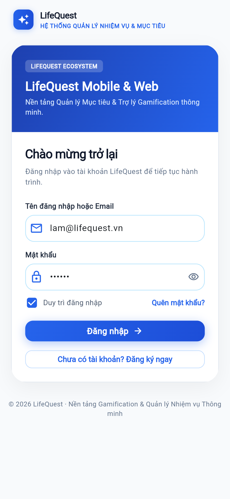{width=40%} 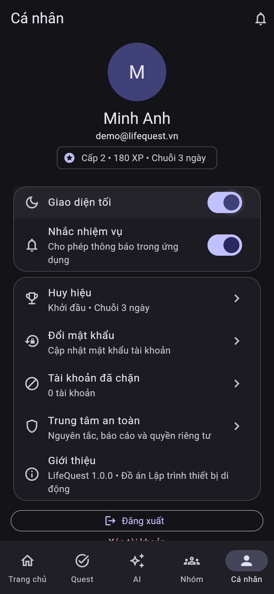{width=40%}

**Mô tả kết quả thực nghiệm:**  
Giao diện ứng dụng được xây dựng theo chuẩn Responsive Design:  
- Trên màn hình lớn (Desktop / Web): Tự động hiển thị thanh điều hướng bên trái (Left Sidebar) cố định, tận dụng không gian ngang để hiển thị chi tiết số liệu.  
- Trên màn hình điện thoại (Mobile): Tự động chuyển đổi sang thanh điều hướng ngăn kéo (Drawer) kết hợp thanh điều hướng dưới đáy (Bottom Navigation Bar), bố trí vùng chạm ngón tay tối thiểu $44 \times 44\text{ px}$.  
- Chế độ tối (Dark Mode) được tối ưu hóa độ tương phản cao với tông nền đen xanh `#0F172A`, bảo vệ thị lực khi sử dụng ban đêm và tiết kiệm pin trên màn hình AMOLED.

---

## 1.3. Kết quả kiểm thử thực tế (Testing & Quality Assurance)

Đồ án được kiểm thử toàn diện thông qua các kịch bản kiểm thử tự động ở cả hai tầng Backend và Frontend:

| Hạng mục kiểm thử | Công cụ / Lệnh thực thi | Số lượng kiểm thử | Kết quả kiểm thử |
|---|---|:---:|:---:|
| **Kiểm tra cú pháp & Chuẩn mã nguồn** | `flutter analyze` | Toàn bộ dự án Flutter | **0 cảnh báo, 0 lỗi (No issues found)** |
| **Kiểm thử giao diện & Logic Mobile** | `flutter test` | 14 test cases | **14/14 ĐẠT (100% PASS)** *(Kiểm thử Auth, Token 401, Quest, XP Idempotent, Gamification Level bình phương, AI moderation, Nhóm mã mời, Đổi mật khẩu)* |
| **Kiểm thử tích hợp Backend & CSDL** | `cd backend && npm test` | 12 test suites | **12/12 ĐẠT (100% PASS)** *(Kiểm thử Xác thực JWT, Rate-limit brute-force 429, Transaction Idempotency, Phân quyền, Nhóm, Chặn người dùng, SSE Realtime, Migration CSDL)* |

---

# 2. KẾT LUẬN VÀ HƯỚNG PHÁT TRIỂN

### 2.1. Các kết quả đã đạt được
1. Xây dựng hoàn chỉnh ứng dụng di động LifeQuest chạy ổn định trên nền tảng Android, iOS và Web với giao diện Minimalism hiện đại, thân thiện và trực quan.
2. Thiết kế kiến trúc Client - Server tách biệt rõ ràng: Backend REST API viết bằng Node.js với CSDL SQLite quan hệ chặt chẽ (9 bảng có khóa ngoại, migration chuẩn mực).
3. Ứng dụng thành công cơ chế Gamification vào quản lý nhiệm vụ đời thường, kết hợp thuật toán Idempotent chống gian lận điểm XP.
4. Tích hợp Trợ lý AI với quy trình kiểm duyệt an toàn (Moderation) và luồng duyệt trước khi lưu (Review-before-save).
5. Hiện thực hóa kết nối thời gian thực qua Server-Sent Events (SSE) giúp các thành viên nhóm làm việc cộng tác mượt mà.
6. Thiết lập cơ chế bảo mật đa lớp: băm mật khẩu bcrypt, băm mã mời SHA-256, phiên JWT và khóa rate-limit chống tấn công dò mật khẩu.
7. Phân quyền chặt chẽ giữa Quản trị viên (Admin Dashboard) và Người dùng (User Experience).

### 2.2. Các mặt hạn chế còn tồn đọng
1. Hệ thống thông báo nhắc nhở hạn chót (Deadline) hiện mới dừng lại ở Notification Center nội bộ trong app, chưa tích hợp Firebase Cloud Messaging (FCM) để đẩy thông báo ra ngoài màn hình khóa hệ điều hành khi ứng dụng đóng hoàn toàn.
2. Backend hiện đang chạy trên môi trường cục bộ (Localhost) hoặc mạng nội bộ; bản web trên Firebase Hosting đang chạy chế độ Demo Local Storage độc lập chưa kết nối trực tiếp với CSDL trên máy chủ đám mây công cộng.
3. Chưa tích hợp hình thức đăng nhập nhanh qua Google Sign-In hoặc phục hồi mật khẩu qua email SMTP thực tế.

### 2.3. Hướng phát triển trong tương lai
1. Triển khai Backend REST API lên các nền tảng máy chủ đám mây công cộng (như Render, Railway hoặc Google Cloud Run) kết nối CSDL PostgreSQL/MySQL để người dùng có thể sử dụng từ bất kỳ mạng 4G/WiFi nào.
2. Tích hợp giao thức Firebase Cloud Messaging (FCM) để gửi thông báo đẩy nhắc nhở lịch trình rèn luyện mỗi sáng.
3. Bổ sung tính năng Bảng xếp hạng thi đua (Leaderboard) hàng tuần trong câu lạc bộ và kênh Chat thảo luận nội bộ giữa các thành viên nhóm.

---

# TÀI LIỆU THAM KHẢO

1. **Flutter Documentation.** (2026). *Building beautiful multi-platform applications with Flutter*. Google Developers. <https://docs.flutter.dev>
2. **Riverpod Documentation.** (2026). *A Reactive Caching and Data-binding Framework for Dart and Flutter*. <https://riverpod.dev>
3. **Node.js Foundation.** (2026). *Node.js v24 LTS Documentation and Built-in Test Runner*. <https://nodejs.org/docs>
4. **SQLite Consortium.** (2026). *SQLite Database Engine, Foreign Keys & WAL Mode*. <https://sqlite.org/docs.html>
5. **OWASP Foundation.** (2025). *Password Storage Cheat Sheet & Authentication Best Practices*. OWASP Series.
6. **IETF RFC 7519.** (2015). *JSON Web Token (JWT) Architecture and Security Guidelines*.
7. **Google AI for Developers.** (2026). *Gemini API Guidelines: Structured Outputs and Content Moderation*. <https://ai.google.dev>
8. **Taste-Skill Guidelines.** (2026). *Anti-Slop Design Principles and Minimalism UI Architecture for Modern Frontend Applications*.
